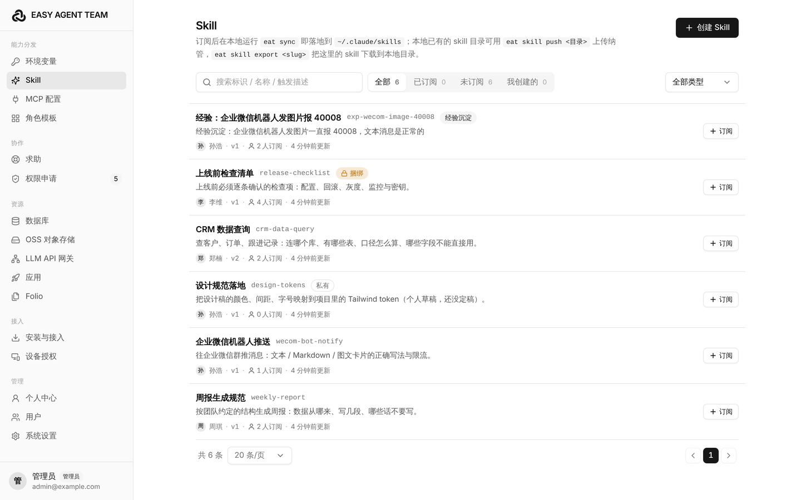
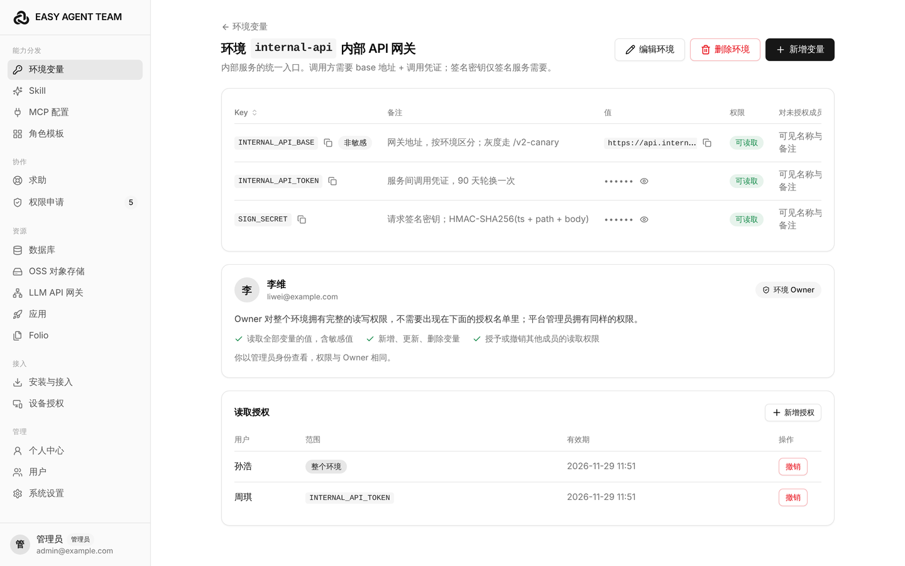
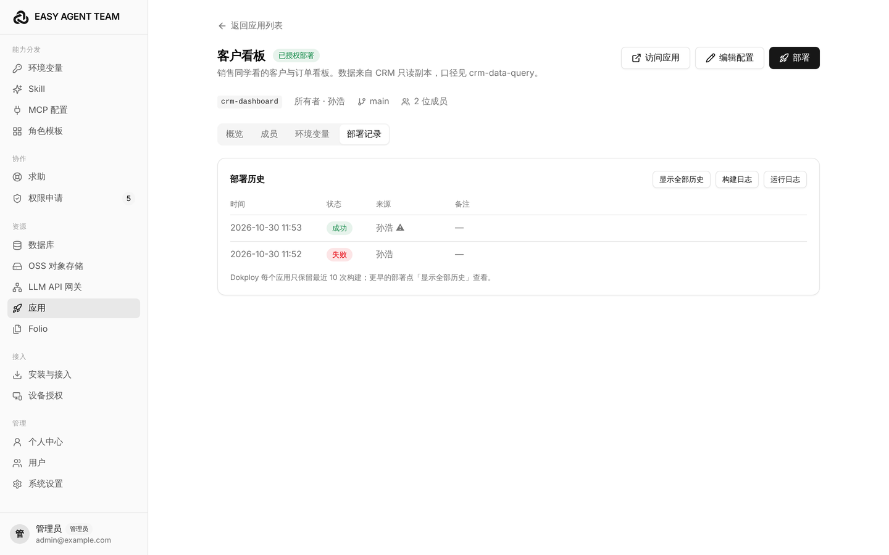
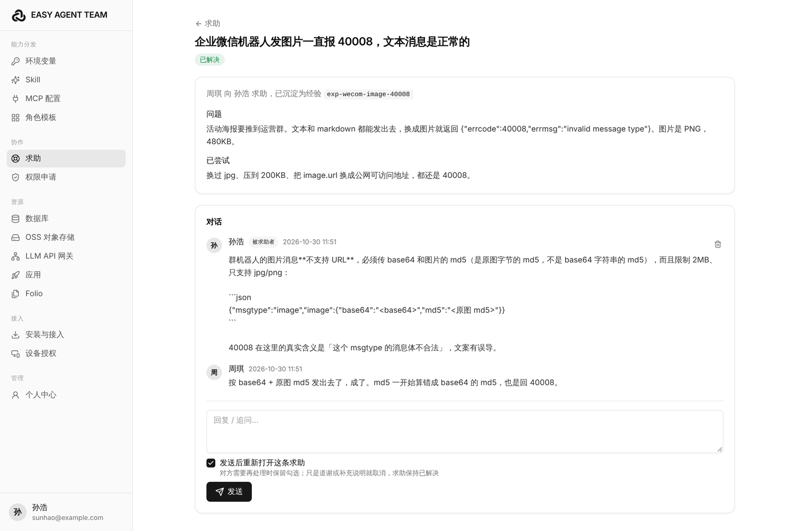
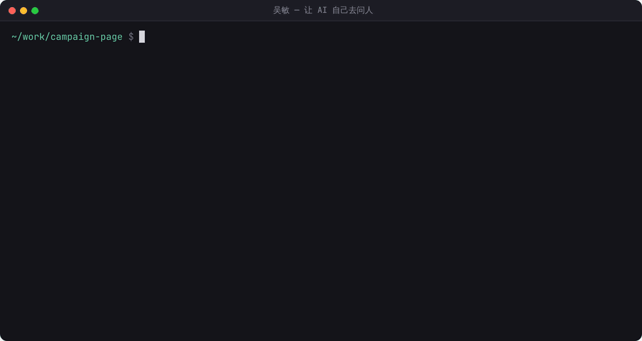
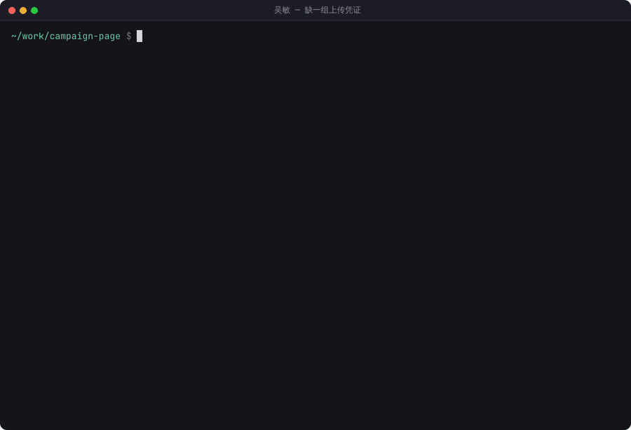
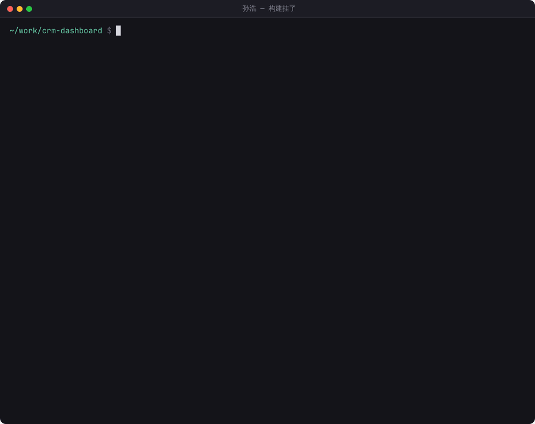
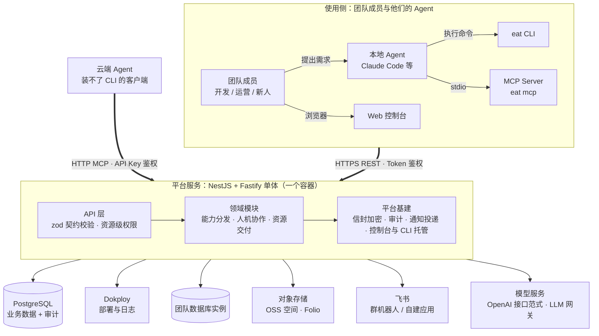

<p align="center">
  
</p>

# easy-agent-team（EAT）

**Agent 的企业 IM。** 人靠 IM 在企业里找人、查资料、走审批、用应用；EAT 给 Agent 同样的入口：
以成员的身份接入，按权限取用团队的规范、凭证、数据库与部署能力，缺权限时自己去申请，缺信息时自己去问知道的人，
做完了直接上线。

AI 已经能写代码、跑分析、做出一个完整的应用；在企业里真正拦住它的，是拿不到数据、没有权限、没地方上线、要等别人。
EAT 是人和 Agent 与企业上下文之间的协调层，把这些障碍收进同一套账号、权限与审计里：
团队里少数人负责建设能力，其他成员——包括不写代码的同事——由自己的 Agent 按权限直接用起来。

## 能力矩阵

| | 能力 |
|---|---|
| **可理解**<br>让 Agent 读懂团队 | 数据持续集成<sup>※</sup> · [Skill 规范](docs/features.md#skill-管理与分发) · [角色模板](docs/features.md#角色模板) · [MCP 配置分发](docs/features.md#mcp-配置分发) |
| **可调用**<br>按权限取用资源 | [环境变量与凭证](docs/features.md#环境变量) · [数据库](docs/features.md#数据库账号分配) · [对象存储](docs/features.md#oss-对象存储) · [LLM 网关](docs/features.md#llm-api-网关) · [应用部署](docs/features.md#部署托管dokploy) · [Folio 页面发布](docs/features.md#folio-发布与评论) |
| **可流动**<br>人与 Agent 间流转 | [求助](docs/features.md#求助系统人机协作) · [权限审批](docs/features.md#环境变量) · [飞书通知与卡片审批](docs/feishu-app.md) · [Folio 评论 @](docs/folios.md) · [GitHub 组织协作](docs/features.md#github-组织协作) |
| **可积累**<br>解决一次，复用多次 | [经验沉淀与检索](docs/features.md#经验沉淀) · [Skill 版本与订阅](docs/features.md#skill-管理与分发) · [审计留痕](docs/features.md#安全与审计) |

<sup>※</sup> 把企业的数据、代码与文档持续集成为 Agent 可检索的内容，由配套的上下文服务系统提供，不在本仓库内。

每一项的完整说明见[功能清单](docs/features.md)。

### 三个入口，一套权限

| 入口 | 给谁用 |
|---|---|
| **Web 控制台** | 人：管理、授权与审批，桌面与手机都能用 |
| **eat CLI** | 电脑本地的 Agent（Claude Code、Codex 等）：命令按模块分组，`eat --help` 查看全部 |
| **MCP** | 本机用 `eat mcp`（stdio）；云端 Agent 用平台自带的 Streamable HTTP 端点 `<平台>/mcp` + API Key |

三个入口背后是同一个身份和同一套资源级权限：Agent 能做的事，不会多于它代表的那个人。

## 长什么样

| Skill：团队规范，订阅即得 | 环境变量：元数据可见，取值受控 |
|:---:|:---:|
| [](docs/assets/screenshots/skills.png) | [](docs/assets/screenshots/env-detail.png) |
| **应用部署：失败可查，修好即上线** | **求助：答复沉淀为经验** |
| [](docs/assets/screenshots/app-deployments.png) | [](docs/assets/screenshots/help-detail.png) |

| `eat sync`：把团队能力同步到本地 Agent | `eat ask`：让 Agent 自己去问人 |
|:---:|:---:|
| [](docs/assets/demos/onboard.gif) | [](docs/assets/demos/ask.gif) |
| **`eat env`：缺权限就申请，批了再拉** | **`eat deploy`：真实报错就在平台里** |
| [](docs/assets/demos/permissions.gif) | [](docs/assets/demos/deploy-fail.gif) |

> 画面全部来自真实运行的平台：演示数据经平台自己的 API 写入，部署是对 Dokploy 的真实构建，命令行是真跑一遍录下来的。
> 控制台每个页面与 CLI 关键流程的全集见[界面截图与录屏](docs/screenshots.md)，重新生成的方法见 [`scripts/demo/`](scripts/demo/README.md)。

## 快速开始

### 团队成员：让自己的 Agent 接入

最省事的方式：打开控制台「安装与接入」页，点「一键复制 Agent 安装指令」，粘贴给自己的 Agent，它会完成安装、登录和同步。
也可以手动执行：

```bash
# macOS / Linux / WSL / Git Bash
curl -fsSL https://<平台地址>/install.sh | sh
```

```powershell
# Windows PowerShell
powershell -ExecutionPolicy ByPass -c "irm https://<平台地址>/install.ps1 | iex"
```

```bash
eat login --server https://<平台地址>   # 设备码登录，浏览器里点一次确认
eat sync                                # 把订阅的 Skill 与 MCP 配置同步到本地
```

CLI 由平台自己分发（不发 npm），版本始终与平台一致，之后用 `eat self-update` 升级。
装不了 CLI 的云端 Agent 改用 MCP：在「安装与接入」页生成 API Key，按页面给出的配置接入 `<平台>/mcp`。

### 部署平台

平台是一个容器：NestJS 单体 + PostgreSQL，控制台与 CLI 安装包都由它托管。仓库根目录提供 `Dockerfile`
（国内网络用 `Dockerfile_cn`），推荐部署在 Dokploy 上。三个必填环境变量：

| 变量 | 说明 |
|---|---|
| `DATABASE_URL` | PostgreSQL 连接串，生产必须指向持久化实例 |
| `EAT_KEK` | 敏感值加密主密钥，32 字节 base64（`openssl rand -base64 32`）。**丢失后密文无法恢复，务必备份** |
| `EAT_PUBLIC_URL` | 平台对外地址，登录授权页、通知卡片与 CLI 安装脚本都用它拼链接 |

其余可选项见 [`.env.example`](.env.example)。镜像构建、Dokploy 部署、首次初始化、备份与 Dokploy 版本兼容性见[部署文档](docs/deployment.md)。
部署完成后，Dokploy、OSS、LLM 网关、飞书通知、GitHub 等外部能力都在控制台「系统设置」里按需接入，不配置不影响其他功能。

### 本地开发

```bash
pnpm install && pnpm build                 # shared → server / cli / web
cp .env.example .env                       # 至少填 DATABASE_URL
pnpm db:migrate && pnpm db:seed            # 初始管理员 admin@example.com / admin12345
node --env-file=.env apps/server/dist/main.js   # http://localhost:3000（含控制台）
node apps/cli/dist/index.js login --server http://localhost:3000
```

跑服务端测试时请用独立的测试库（测试会重建 schema），例如
`TEST_DATABASE_URL=postgres://…/eat_test pnpm --filter @eat/server test`。
改了 CLI 或内置平台指南时记得递增对应的版本号，约定与其他工程细节见 [`CLAUDE.md`](CLAUDE.md)。

## 架构



- **单体 + 单库**：API 与后台任务在同一个 NestJS 进程里，业务数据与审计写进同一个 PostgreSQL，不引入 Redis、不部署独立 worker。
- **三端一套契约**：请求 / 响应以 zod 定义在 `packages/shared`，服务端、CLI、控制台共用同一份类型。
- **Agent 是一等用户**：面向人的能力都有对应的 CLI 命令与 MCP 工具，Agent 能自己办，不需要人转述。
- **元数据公开、取值受控**：Agent 默认看得到某个配置存在、用来做什么，取值要授权；没权限时给出可以直接执行的申请命令，而不是静默失败。

## 文档

| 文档 | 内容 |
|---|---|
| [功能清单](docs/features.md) | 按四个支柱整理的全部能力与入口 |
| [界面截图与录屏](docs/screenshots.md) | 控制台每个页面与 CLI 关键流程 |
| [产品设计文档](docs/product-design.md) | 产品与技术设计的唯一事实源：权限模型、数据模型、接口与全部决策记录 |
| [部署文档](docs/deployment.md) | 镜像构建、Dokploy 部署、备份、升级、CLI 分发与 Dokploy 版本兼容性 |
| [系统设置](docs/settings.md) | 管理员设置的分类、直达链接与界面 |
| [内置平台指南](docs/platform-guide.md) | `eat-platform-guide` 的组织方式与分发 |
| [Folio 发布与评论](docs/folios.md) · [上传协议](docs/folio-uploads.md) · [CDN 加速](docs/folio-cdn.md) | 独立页面发布、访问控制、评论与运维 |
| [OSS 对象存储](docs/oss-storage.md) | 空间申请审批、共享凭证、公开读与管理凭证权限 |
| [LLM API 网关](docs/llm-gateway.md) · [额度一致性](docs/llm-gateway-consistency.md) | 个人模型 Key、额度与接入升级 |
| [飞书自建应用通知](docs/feishu-app.md) | 通知渠道切换、机器人私聊与审批卡片 |
| [GitHub 组织协作接入](docs/github.md) | GitHub App 接入向导、身份关联与仓库权限 |
