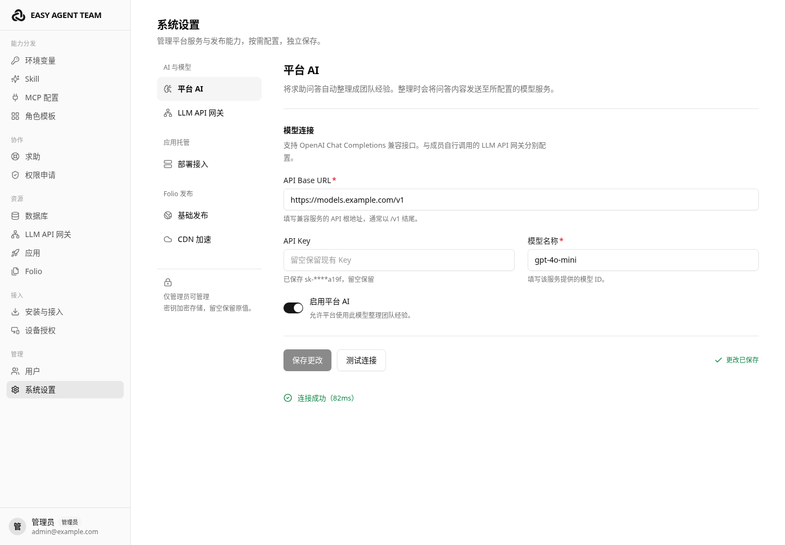
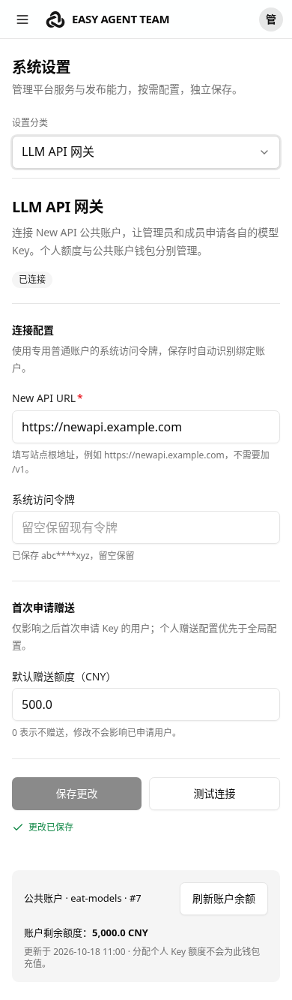

# 系统设置

系统设置仅管理员可访问。设置按任务分为三组，每次只显示当前分类：

| 分组 | 分类 | 配置内容 | 直达地址 |
|---|---|---|---|
| AI 与模型 | 平台 AI | 自动整理团队经验使用的模型连接与开关 | `/settings?section=platform-ai` |
| AI 与模型 | LLM API 网关 | New API 公共账户连接、首次申请赠送、公共钱包余额 | `/settings?section=llm-gateway` |
| 应用托管 | 部署接入 | Dokploy 连接、项目、环境、SSH Key、自动域名 | `/settings?section=deployment` |
| Folio 发布 | 基础发布 | 发布入口、私有 OSS、四种 HTTPS 证书方式、启停检查 | `/settings?section=folio` |
| Folio 发布 | CDN 加速 | 阿里云 CDN 凭证、区域、回源校验、DNS 与接入恢复 | `/settings?section=folio-cdn` |

平台 AI 与个人模型 API 网关各有用途和凭证，分别配置。Folio 基础发布与 CDN 分开保存；接入 CDN 前须先保存基础发布配置。
已有 `/settings#static-sites` 链接继续打开基础发布。

## 布局与操作

桌面采用左侧分组导航与右侧当前表单；窄屏使用顶部固定的分类选择器，表单改为单列，操作按钮可换行。
字段根据内容区域的实际宽度决定是否并排，避免平台侧栏和设置导航挤压表单。

设置中的下拉框、复选框与开关统一使用项目现有的 shadcn/ui 风格组件（Radix UI + Tailwind）。移动端分类保留分组，下拉菜单限制在视口内，长选项可换行；支持键盘选择、必填错误定位和不可用选项。勾选或切换后仍需保存才生效。

每个分类独立保存，统一显示未保存、保存中、保存成功或失败状态。保存失败保留输入，成功后清空凭证输入；凭证留空保留原值，已有值只显示掩码。
连接测试单独反馈，修改连接信息后清除旧测试结果。Folio 启用和 CDN 接入仍按后台实际状态显示，保存配置不等于已经启用。

在本页切换分类或使用浏览器前进、后退会保留已编辑内容；离开页面或刷新后，未保存内容不会保留。
首次进入只读取当前分类，访问后保留该表单；隐藏分类暂停定时查询，切回时刷新状态。

成员直接访问设置地址时只看到权限说明，不请求管理员配置。服务端仍负责所有管理员接口的权限校验。

## 界面与验证

参考 [Impeccable](https://github.com/pbakaus/impeccable) 的任务型界面、响应式布局与表单反馈建议，沿用平台现有字体、颜色和控件。



[查看 CDN 设置与接入状态截图](assets/screenshots/settings-cdn.png)

[桌面下拉菜单](assets/screenshots/settings-cdn-menu.png) · [移动端下拉菜单](assets/screenshots/settings-mobile-cdn-menu.png)



可复现浏览器检查使用真实 Web 构建产物和本地 API 模拟数据，不修改实际系统配置；写入请求通过 shared 契约校验。

```bash
pnpm --filter @eat/shared build
pnpm --filter @eat/web build
node scripts/test-settings-ui.mjs
```

需要本机 Chromium，默认路径 `/usr/bin/chromium`，可用 `CHROMIUM_PATH` 指定；截图默认写入系统临时目录 `eat-settings-ui`，可用 `EAT_SETTINGS_SCREENSHOTS` 指定。
覆盖 1440、1024、900、899、768、720、390、320 像素视口，检查分类直达与历史、键盘导航、草稿保留、加载重试、保存成功及失败、凭证掩码、连接测试、部署选项及手填回退、Folio 四种证书方式与启停、CDN 配置及恢复、隐藏轮询、成员权限和横向溢出。
截图与视口测试来自 Chromium，不代替真实设备上的浏览器验收。
